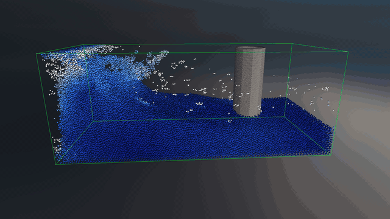
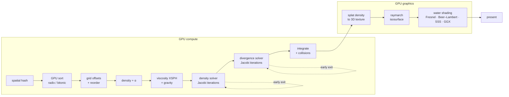
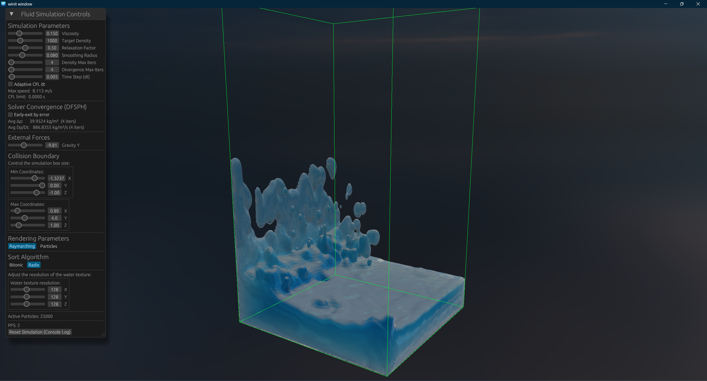
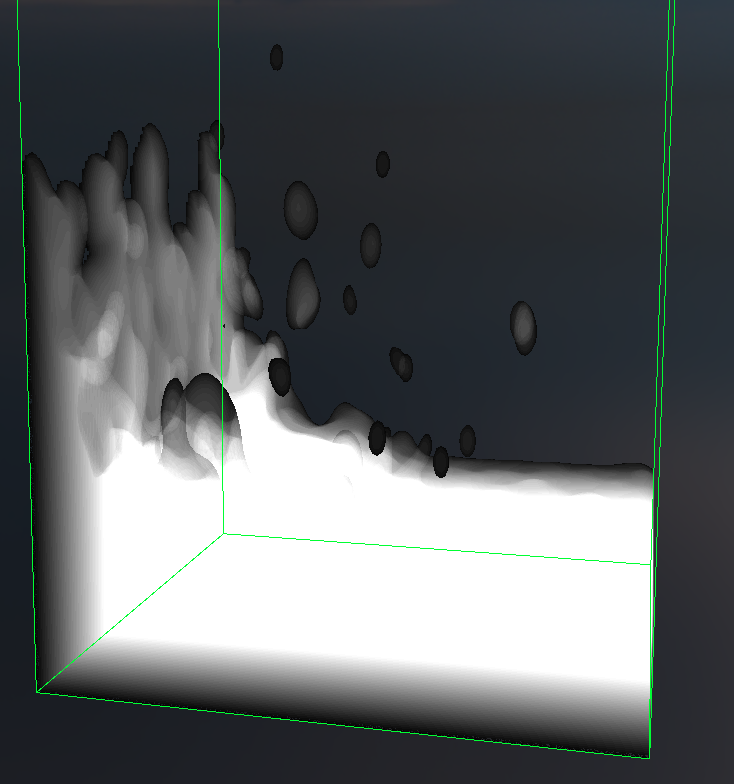
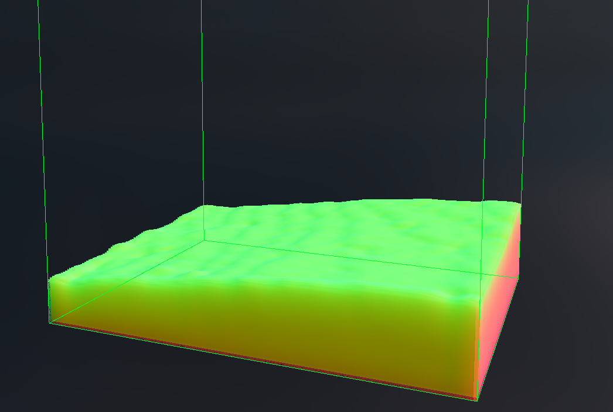
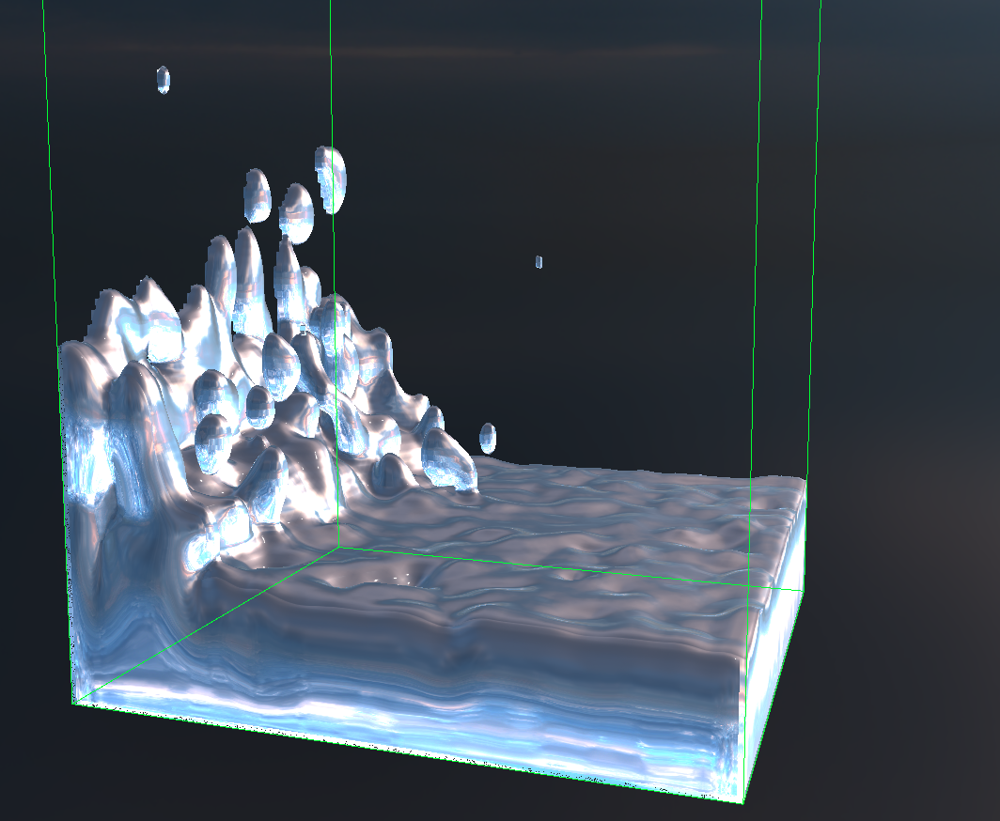
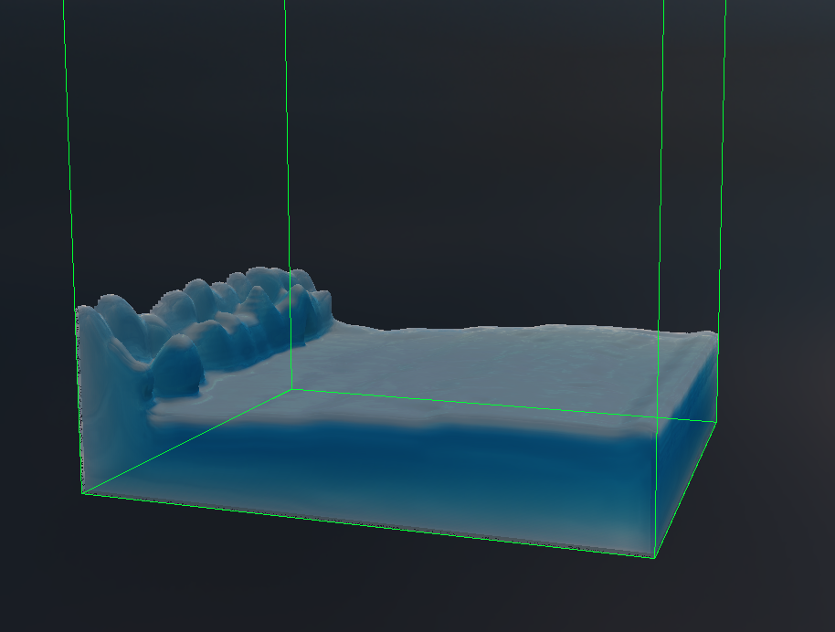

<div align="center">

# Fluid Engine

**Real-time SPH fluid simulation, computed and rendered entirely on the GPU.**

Written from scratch in Rust on top of the Vulkan API — no game engine, no physics middleware.




<sub>~155k particles; a moving wall pushes waves around a pillar. Rendered offline with <code>cargo run --release --bin showcase</code>.</sub>

</div>

---

## What is this?

A personal project I built during my studies to understand — at the lowest practical level — how modern real-time particle simulations actually work. Instead of using an existing engine, every layer is implemented by hand:

- the **physics**: a Divergence-Free SPH (DFSPH) solver that keeps the fluid incompressible,
- the **acceleration structures**: spatial hashing with GPU sorting and cache-friendly buffer reordering,
- the **rendering**: volumetric raymarching with a physically-motivated water shading model,
- the **engine glue**: windowing, input, camera, GPU resource management and frame synchronization.

The CPU's only job is to record Vulkan command buffers. Every simulation and rendering step — neighbor search, sorting, pressure solves, integration, density splatting, raymarching — runs as GPU compute or graphics work, every frame, in real time.

## Highlights

- 🌊 **DFSPH solver** ([Bender & Koschier 2015](https://animation.rwth-aachen.de/media/papers/2015-SCA-DFSPH.pdf)) — two cooperating pressure solvers, one for the density error and one for the velocity divergence, both warm-started from the previous step and checked against [SPlisHSPlasH](https://github.com/InteractiveComputerGraphics/SPlisHSPlasH)
- 🛑 **Early exit on the GPU** — after every Jacobi iteration a one-thread shader compares the average compression error with the threshold and zeroes the indirect dispatch arguments of the remaining iterations, so a converged solve needs no CPU round trip
- 🧱 **Analytic boundaries** — box walls and a pillar contribute the cubic-spline kernel integrated over the solid side (closed form, derived symbolically), so the solver feels them without boundary particles
- 🔍 **Neighbor search with locality** — spatial hash on the Morton code of each cell, GPU sort, reorder of all particle data, then a neighbor list built once per substep and read by every later pass
- 🔀 **Two GPU sorters, benchmarked** — bitonic and 8-bit radix sort, switchable at runtime
- ⏱️ **Command buffers recorded once** — the whole substep is recorded once and resubmitted; per-frame values reach the GPU with `vkCmdUpdateBuffer`
- 💡 **Volumetric water rendering** — density splatted into a 3D texture, raymarched isosurface, Fresnel, Beer–Lambert absorption, subsurface scattering, GGX specular and HDRI lighting (a particle view is also available)
- 🖱️ **Interactive** — pull the water with the mouse, toggle the moving wall and the pillar, tune every solver parameter live (egui)
- 📊 **Measured, not guessed** — per-pass GPU timestamps, solver-iteration and convergence tests, a frame-time benchmark mode and Tracy integration

## How a frame works



Both pressure solvers share the same matrix-free Jacobi iteration (`pressure_update` → `pressure_force` → `solver_check`); they differ only in the source term — predicted density deviation `(ρ₀ − ρᵢ)/Δt − ∇·v` versus divergence `−∇·v` — and in whether the result integrates positions or only velocities. Each solve starts from half of the previous step's pressure and stops once the average compression error drops below 0.1 % of ρ₀.

## Rendering breakdown

<div align="center">

</div>

The water surface is never meshed. Particle densities are splatted into a `R32Uint` 3D texture (atomic adds, smooth `(1−q²)³` falloff), and a fragment shader marches camera rays through it — AABB entry test, fixed-step march, then 8 bisection steps to pin the isosurface to ~0.4% of a step. Surface normals come from central differences on the density field.

| Thickness (drives absorption) | Normals |
|:---:|:---:|
|  |  |
| **Specular reflection** | **Refraction + subsurface scattering** |
|  |  |

The final color blends refraction (background through Beer–Lambert absorption, tinted by wrapped-diffuse SSS) with reflection by the Schlick–Fresnel factor, adds a GGX sun highlight and a foam mask on thin, upward-facing regions, then tonemaps with Reinhard. Both reflected and refracted rays sample the same equirectangular HDRI panorama, keeping the lighting consistent between water and sky.

## Performance notes

Particle view, 1920×1080, RTX 3050 Laptop GPU, one 5 ms substep per frame:

| Particles | Frame rate |
|---|---|
| 25k | ~110 FPS |
| 100k | ~50 FPS |

What got it there, each step measured with the benchmarks below:

| Change | Effect |
|---|---|
| Cap substeps per frame instead of chasing the wall clock | 25k particles: 4.8 → 25 FPS (raymarching) |
| Apply the last Jacobi update, warm start, correct error metric | early exit actually triggers; fewer iterations |
| Neighbor lists built once per substep | ~4× faster per solver pass |
| Morton-ordered cell hash | 100k particles: 48 → 12 ms per substep (data stays in cache) |
| Substep command buffer recorded once | CPU recording cost per substep → ~0 |

Bitonic sort is the default: once command buffers are recorded only once, only GPU time matters, and bitonic is faster up to ~250k particles (0.24 ms vs 1.0 ms per neighbor search at 25k particles). Radix wins for larger counts and when every dispatch is re-recorded each frame.

```bash
cargo test --release -- --ignored substep_benchmark --nocapture            # per-pass GPU time
cargo test --release -- --ignored solver_iterations_over_time --nocapture  # iterations over 3 s
FLUID_PARTICLES=100000 FLUID_BENCH_SECONDS=10 FLUID_BENCH_MAX_SUBSTEPS=1 \
  FLUID_BENCH_RENDER=particles cargo run --release --bin main              # frame times
```

## Getting started

**Requirements**

| | |
|---|---|
| OS | Windows 10 (2004+) |
| GPU | Vulkan 1.3 capable (GTX 1000 / RX 400 class or newer) |
| Toolchain | Rust 1.85+ (edition 2024), MSVC Build Tools |
| SDK | [Vulkan SDK](https://vulkan.lunarg.com/) 1.3.x (provides `shaderc` for build-time GLSL → SPIR-V compilation) |

**Build & run**

```bash
git clone https://github.com/Nikita-Lysiuk/Fluid-Engine.git
cd Fluid-Engine
cargo run --release --bin main
```

Shaders are compiled to SPIR-V at build time by `vulkano-shaders` — no manual compile step. `FLUID_PARTICLES=25000` changes the particle count (default 100k).

**Render the animation above**

```bash
cargo run --release --bin showcase      # PNG frames into target/showcase
scripts/showcase_gif.sh                 # GIF into docs/showcase.gif (needs ffmpeg)
```

**Controls**

| Input | Action |
|---|---|
| `LMB` on the water | pull the water towards the cursor (a circle shows the reach) |
| Mouse wheel while pulling | move the pull point closer / further |
| `RMB` held + mouse | look around |
| `W` `A` `S` `D` | move camera |
| `E` / `Q` | move up / down |
| UI panel | solver parameters, moving wall and pillar toggles, render mode (raymarching ↔ particles), sort algorithm, CFL, substeps per frame (0 pauses) |

## Project structure

```text
src/
  app.rs, input.rs, camera.rs, scene.rs  # window events, controls and scene state
  showcase.rs                            # offline renderer for the README animation
  sim/                                   # particle buffers, solver passes and statistics
    sort/                                # bitonic and radix GPU sorters
    benchmarks/                          # simulation diagnostics and benchmarks
  render/                                # Vulkan setup, frame resources, graphics and UI
shaders/                                 # compute, vertex and fragment shaders
scripts/                                 # benchmark and plotting tools
docs/                                    # technical write-up and refactoring plan
```

**Stack:** [vulkano](https://github.com/vulkano-rs/vulkano) (safe Vulkan wrapper), [winit](https://github.com/rust-windowing/winit), [egui](https://github.com/emilk/egui), [glam](https://github.com/bitshifter/glam-rs) (SIMD math), [tracy-client](https://github.com/wolfpld/tracy) (profiling).

## Known limitations & roadmap

- The solver needs about 3× more Jacobi iterations than SPlisHSPlasH on the same scene (≈9 vs 3 for density); the cause is still open.
- 100k particles run at ~50 FPS on a laptop RTX 3050, but only one 5 ms substep fits in a frame, so the water then moves at about a third of real time.
- The CPU still waits for the GPU at the end of each frame; letting them overlap currently trips a resource-locking panic in vulkano 0.35.
- The raymarched surface looks like separate blobs and the material is too matte; screen-space fluid rendering is the next step.

Planned / interesting next steps:

- [ ] Screen-space fluid rendering and a better water material
- [ ] Overlap CPU and GPU work between frames
- [ ] Surface tension (droplets, capillary effects)
- [ ] Hardware ray tracing (`VK_KHR_ray_tracing_pipeline`) for caustics
- [ ] Linux/macOS support

A detailed write-up of the theory, design decisions and measurements (in Polish) lives in [`docs/Fluid_Simulation`](docs/Fluid_Simulation).

## References

- J. Bender, D. Koschier — [*Divergence-Free Smoothed Particle Hydrodynamics*](https://animation.rwth-aachen.de/media/papers/2015-SCA-DFSPH.pdf), SCA 2015
- D. Koschier et al. — [*SPH Techniques for the Physics Based Simulation of Fluids and Solids*](https://sph-tutorial.physics-simulation.org/), Eurographics Tutorial 2019
- S. Green — [*Particle Simulation using CUDA*](https://developer.download.nvidia.com/assets/cuda/files/particles.pdf), NVIDIA 2010
- M. Teschner et al. — *Optimized Spatial Hashing for Collision Detection of Deformable Objects*, VMV 2003
- T. Harada, J. Howes — *Introduction to GPU Radix Sort*, 2011
- M. Levoy — *Display of Surfaces from Volume Data*, IEEE CG&A 1988
- J. Bender, T. Kugelstadt, M. Weiler, D. Koschier — *Implicit Frictional Boundary Handling for SPH*, IEEE TVCG 2020 (volume maps)
